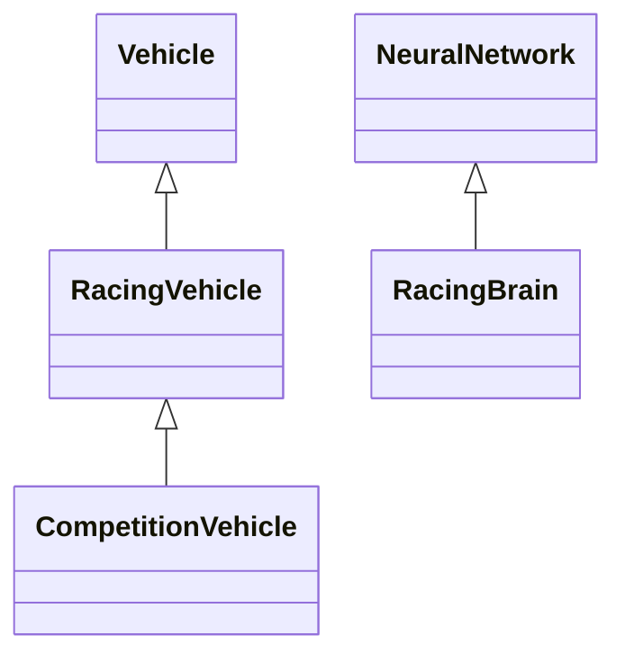

# AI Racing Evolution Simulator — Nice Circuit

Projet universitaire d'IA réactive : des voitures apprennent à parcourir un circuit
par neuro-évolution, puis leurs cerveaux sont évalués et mis en compétition.
Technologies : JavaScript, p5.js 0.8.0 et TensorFlow.js 1.1.0, versions du cours
conservées. Mini-projet ML5 séparé inclus. Référentiel retenu pour la remise :
pages **physiques 52–55** du PDF *Steering behaviors Master Miage IA2*, sujet
Nice 2025–2026, conformément à la mission de finalisation. Les échéances anciennes
du PDF ne sont pas transposées automatiquement à la promotion actuelle.

## Informations de livraison à compléter

- Auteur(s), groupe et promotion : **[À COMPLÉTER]**
- URL GitHub du dépôt : [AbderrahmaneNahhal/AI-Racing-Simulator](https://github.com/AbderrahmaneNahhal/AI-Racing-Simulator)
- URL du jeu hébergé, GitHub Pages ou itch.io : **[À COMPLÉTER]**
- URL YouTube, démonstration de 1 à 2 minutes : **[À COMPLÉTER]**

Aucun hébergement, résultat de champion, expérience personnelle ou lien de remise
n'est inventé. Compléter les champs avant remise.

## Lancement et hébergement statique

Aucun build ni paquet npm à installer. Ouvrir ce dossier dans **VS Code Live Server**, ou lancer depuis ce dossier avec Python installé :

```powershell
python -m http.server 8000 --bind 127.0.0.1
```

Ouvrir <http://127.0.0.1:8000/>. Utiliser localhost ou HTTPS, pas `file://`.
Internet est nécessaire pour les CDN p5.js, TensorFlow.js et ML5.

Pour GitHub Pages : copier **le contenu de ce dossier** à la racine du dépôt de
livraison, puis activer Pages dans les paramètres GitHub, branche choisie et dossier racine.
Le fichier `index.html` est déjà à la racine ; les chemins locaux sont relatifs,
compatibles avec un site de projet GitHub Pages. Aucun déploiement n'a été effectué.
Vérifier ensuite les modes, le Garage et ML5 depuis l'URL publique.

**Exporter les champions JSON avant de changer d'origine** : IndexedDB est propre
à l'origine du navigateur. Les cerveaux locaux ne sont pas transférés automatiquement.

## Modes et contrôles

- **Training** : population, sélection et mutation. Play/Pause/Reset, vitesse
  ×1–×10, progression, succès et graphique par génération.
- **Demo** : importer un cerveau JSON ; une voiture aux poids figés, sans mutation
  ni reproduction. Changer de circuit mesure une autre condition ; Reset réutilise
  le même cerveau. Revenir à Training recrée une population.
- **Contre-la-montre** : 2–8 cerveaux, mêmes conditions initiales que Training,
  départs décalés lorsque la zone est libre, attente sans simulation ni rendu
  superposé. Aucune interaction ; classement des arrivants par pas actifs.
- **Simultanée** : grille orientée sûre, séparation/évitement, suivi/freinage et
  dépassement si le couloir est libre. Pas de mutation ni de réentraînement.

Training → Race conserve population, cerveaux, historique, paramètres, circuit,
caméra et état d'arrêt. Retour en pause. Accueil suspend sans réinitialiser.
Cliquer sur une voiture pour la sélectionner ; Capteurs/D, Checkpoints, zoom,
suivi et Vue globale restent disponibles. Le dessin des voitures reste **×2**.

## Architecture et héritage Vehicle



Training/Demo instancient `RacingVehicle`, Race instancie `CompetitionVehicle`.
Les constructeurs délèguent au parent, les forces passent par `applyForce` et la
locomotion reste héritée de `Vehicle.update`. Les cinq fichiers pédagogiques
`vehicle.js`, `ga.js`, `nn.js`, `ray.js`, `boundary.js` sont inchangés.

| Modules | Responsabilité |
|---|---|
| `racingVehicle.js`, `CompetitionVehicle.js` | Entités spécialisées et diagnostics/rendu. |
| `racingBrain.js`, `trainingConfig.js`, `brainStorage.js` | Réseau, validation et JSON compatibles. |
| `sketch.js`, `evolution.js`, `simulationModes.js` | Boucle, générations, arrêt et préservation des sessions. |
| `raceSession.js`, `raceGrid.js`, `raceInteractions.js` | Compétition, steering et contraintes de contacts. |
| `tracks.js`, `trackStorage.js` | Presets, génération et interchange de circuits. |
| `garageStore.js`, `garageService.js`, `garageDashboard.js` | IndexedDB, vérification et bibliothèque. |
| `dashboard.js`, `simulationControls.js`, `raceDashboard.js`, `performanceChart.js` | Interface et mesures une fois par frame. |
| `camera.js`, `scenery.js`, `sceneryViewport.js`, `racingArt.js`, `appShell.*` | Présentation sans déplacement des agents. |
| `ml5-demo/` | Atelier ML5 isolé du simulateur. |

## Perception, steering et physique

Les rayons couvrent 90° : angle `-45 + i × 90 / capteurs`. Chaque entrée vaut
`1 − distanceDuMur / SIGHT`. Le réseau produit un angle relatif et une vitesse
désirée. `Vehicle.look` calcule `steering = vitesseDésirée − vitesseActuelle`,
avec force limitée à 0,2 et vitesse limitée à 5 unités/pas.

La locomotion fournie fait `pos += vel`, puis `vel += acc`, limite la vitesse et
remet l'accélération à zéro. Training/Demo conservent l'ordre
`applyBehaviors → check → update`. Il n'y a pas de trajectoire préenregistrée.

En simultanée, les comportements locaux combinent risque par vitesses relatives,
séparation, évitement, freinage/suivi et couloir de dépassement. Les forces sont
pondérées et limitées ; une manœuvre aggravant le risque de mur est rejetée.
La tangente locale sert de repère au départ arrêté et de contrainte de marche
arrière, sans remplacer le cerveau par un suivi de chemin imposé.

L'évitement ne garantit pas à lui seul les contacts : des **disques de rayon 8**
sont testés continûment avant le prochain déplacement hérité. La réponse bloque
la vitesse dangereuse sans téléportation. Un corps terminé reste visible et
solide six pas avant retrait. Le modèle fourni de collision aux murs repose
sur les rayons (distance <5), pas sur une carrosserie rectangulaire continue.

## Réseau neuronal et paramètres

Les curseurs affichent leur valeur numérique. Modifier puis **Appliquer et
réinitialiser** recrée des réseaux compatibles en pause, sans altérer le Garage.

| Paramètre | Domaine / valeur initiale |
|---|---|
| Population | 10–300 / 100 |
| Mutation | 0–100 % / 10 % |
| Entrées / capteurs | 3–15 / 6 |
| Distance de vision | 20–200 / 50 |
| Couches cachées | 1–3 / 1 |
| Neurones de chaque couche | 4–48, largeur indépendante / 12 |
| Activation des couches cachées | Sigmoid ou ReLU / Sigmoid |

Exemple effectif : **6 → 12 → 8 → 2**. Les curseurs supplémentaires apparaissent
selon le nombre de couches. La topologie affichée correspond aux modèles actifs.
ReLU modifie réellement leurs calculs. Les **sorties restent sigmoïdes**, car
l'interprétation physique de direction/vitesse attend des valeurs entre 0 et 1.

Les anciens cerveaux `ai-racing-brain` v1 sans nouveaux champs gardent exactement
Sigmoid et des couches uniformes. ReLU ou les largeurs non uniformes s'exportent
en **v2** ; les Sigmoid uniformes restent exportables en v1. Les deux formats
sont acceptés, avec validation des formes et des valeurs, sans modifier les poids.
Un ancien exécutable n'est pas censé comprendre les nouveaux v2.

## Algorithme génétique et fitness

La progression brute est le nombre de checkpoints franchis dans l'ordre, sur 60.
Le checkpoint 0 clôt le tour ; aucun checkpoint n'est offert au départ.
Avant la sélection, le code fourni transforme la progression en
`score = 2^min(progression,500)`, puis en probabilités normalisées. Une réduction
par le maximum préserve la stabilité numérique.

La roulette pondérée choisit un parent, copie son réseau puis applique la mutation
gaussienne héritée à chaque paramètre avec la probabilité configurée. Pas de
rétropropagation en Training, crossover ajouté ou élitisme non muté. L'archive du
meilleur cerveau est distincte de la population reproduite. `evolution.js` fournit
la fabrique configurable ; la normalisation de `ga.js` reste réutilisée.

La fitness ne récompense pas directement le temps. Race classe par pas actifs.
Les probabilités de sélection ne sont pas des checkpoints. Les statistiques sont
capturées avant normalisation. Les courbes affichent la meilleure progression et
la moyenne des générations terminées ; les 60 dernières sont visibles et
l'historique complet reste en mémoire jusqu'au Reset.

## Arrêt automatique de Training

Dans **Arrêt automatique**, activer indépendamment un maximum de générations
terminées et/ou un objectif de réussite (pourcentage de voitures arrivées).
Cliquer **Appliquer les conditions**. Les deux critères sont désactivés par défaut.
Si plusieurs critères sont actifs, le premier satisfait suffit.

L'évaluation se fait à la fin d'une génération, **avant** normalisation,
reproduction ou destruction des parents. Statistiques et champion restent
disponibles et la raison s'affiche. Export/Garage restent utilisables.
**Play** reproduit les parents conservés et reprend ; les critères sont réévalués
à la prochaine fin de génération, sauf désactivation. **Reset** recommence la
série avec les mêmes réglages et critères. L'état d'arrêt survit aux changements
de mode ; il n'est pas une propriété d'un cerveau JSON ni une règle Demo/Race.

## Garage IA et export des champions

1. Laisser Training progresser ou terminer une génération.
2. Choisir éventuellement un nom et **Ajouter le champion au Garage**.
3. Le succès n'est annoncé qu'après confirmation de la transaction IndexedDB.
4. En Race, choisir 2–8 cerveaux du Garage, un circuit et un format, préparer puis Start.
5. Dans le Garage, **Export JSON** crée un fichier portable pour la remise ou le partage.
   **Import JSON** le recharge. Training propose aussi l'export du meilleur cerveau archivé.

Les captures de génération en cours sont distinguées des résultats archivés.
Les anciennes métadonnées manquantes restent inconnues. À modèle et poids
identiques, une meilleure progression actualise la provenance sans dupliquer le
cerveau, changer son nom/identifiant ni réécrire ses poids. Une moins bonne ne
remplace pas la meilleure. Les renseignements absents d'une nouvelle observation
ne sont pas inventés à partir d'un événement plus ancien.

IndexedDB n'est pas effacé ni migré destructivement. Le Garage est propre à
l'**origine** : localhost, GitHub Pages et itch.io ne partagent pas leurs données.
**Exporter les vrais champions avant de changer d'origine** et joindre les JSON
à la remise. Une bibliothèque locale n'est pas automatiquement livrée avec Git.

## Génération, sauvegarde et restauration des circuits

Facile (graine 124), Moyen (428) et Difficile (739) restent disponibles et inchangés.
Dans **Générateur et sauvegarde de circuits**, choisir base, graine, complexité et
demi-largeur, puis **Générer et utiliser**. La variante validée devient Personnel,
également utilisable en Race. Cette action recommence la session en pause.

- **Sauvegarder / Restaurer circuit** : un emplacement localStorage.
- **Exporter / Importer circuit JSON** : format `ai-racing-track` v1.
- Le fichier conserve nom, monde 1200×800, 60 checkpoints, paramètres complets,
  graine et **sommets exacts**. Ces sommets sont l'autorité à l'import, sans
  approximation due à une autre version du bruit.
- Validation avant utilisation : bornes, segments dégénérés, ordre et nombre des
  sommets, auto-intersections, bordures/checkpoints croisés, chaussée et largeur.
  Un JSON invalide ne remplace pas le circuit.
- Un seul emplacement Personnel est actif ; plusieurs fichiers permettent d'en
  conserver plusieurs. Une configuration d'entraînement sauvegardée sur Personnel
  embarque aussi son circuit exact.

Il s'agit d'un **générateur paramétrique**, pas d'un éditeur graphique. Certaines
combinaisons sont rejetées : changer de graine, réduire la complexité ou élargir
la piste. Pour reproduire un essai sur une variante, conserver cerveau **et** circuit.

## Généralisation : entraînement et évaluation

Un cerveau entraîné sur un circuit ne garantit pas la réussite avec un autre
départ ou du trafic. Demo utilise les mêmes poids sans mutation. Le
contre-la-montre est la référence de départ Training ; la simultanée ajoute grille,
contraintes locales et interactions. Ne pas attribuer automatiquement leurs
différences à un manque de généralisation neuronale.

En simultanée, le premier seuil de compteur est 150, puis le seuil Training 25.
La comparaison stricte `counter > seuil` élimine au 151e ou au 26e update sans
progression. Un trafic prouvé peut suspendre le compteur au plus 60 pas consécutifs
et 180 cumulés, sans réduire le temps de course. Aucun checkpoint artificiel.

Protocole conseillé : exporter un vrai champion ; fixer poids/circuit/départ,
mesurer progression, cause et pas actifs ; changer ensuite une seule condition
à la fois. Les fixtures de tests ne sont pas des champions. Aucun résultat 8/8
ni taux réel d'entraînement n'est fabriqué dans cette livraison.

## Mini-projet ML5 réel et indépendant

Ouvrir [ml5-demo/index.html](ml5-demo/index.html), ou Atelier ML5 dans Training.
Cliquer **Charger ML5 et les exemples**, choisir une couleur puis **Classer avec ML5**.
On peut ajouter ses propres couleurs et familles, jusqu'à 64 exemples par visite.

L'API réelle **ML5 0.12.2**, `ml5.KNNClassifier()`, apprend huit exemples RGB
étiquetés et `classify(...,3)` renvoie les votes de voisins. Les exemples sont
manuellement définis pour cet atelier ; ce ne sont pas des cerveaux automobiles
ou des mesures scientifiques du simulateur. Le vote n'est pas une probabilité
calibrée, et le descripteur RGB ne reconnaît pas une voiture dans une photo.

La page est isolée : aucune caméra, aucun micro, aucune substitution du TF.js 1.1
du simulateur. Le CDN ML5 est chargé seulement après action utilisateur. Le test
Edge exécute une véritable prédiction et vérifie l'absence d'effet sur les tenseurs
du simulateur. Références : [exemples officiels ML5](https://ml5js.github.io/ml5-examples/public/)
et [bibliothèque ML5](https://github.com/ml5js/ml5-library).

## Tests, performances et limites

La source avait **125/125 tests unitaires réussis** avant préparation.
L'intégration complète **Edge a été réexécutée avec succès depuis cette copie** :
Training, Demo, Garage et persistance, les deux formats Race (2–8, ×1/×10), JSON,
circuits et véritable prédiction ML5. Aucune erreur JavaScript non interceptée observée.
Les tests, captures et audits restent dans le projet original, hors de cette copie statique.

- ×1–×10 désigne des pas par frame, pas une multiplication de la physique. Le
  temps réel dépend du FPS, le classement utilise les pas actifs.
- Pas de garantie universelle de 60 FPS avec 300 voitures ou à ×10.
- Collision aux murs par rayons fournis ; contacts inter-voitures uniquement en simultanée.
- Les silhouettes ×2 peuvent se chevaucher avant les disques physiques de rayon 8.
- Les risques évités sont une estimation, pas une preuve causale.
- Reset efface historique et champion de la série, **pas le Garage**.
- Les compteurs de tenseurs ne mesurent pas toute la mémoire du navigateur.
- Les CDN nécessitent Internet, y compris après publication statique.

## MON EXPERIENCE

**Rubriques à rédiger personnellement avant remise. Ceci n'est pas un récit
certifié ou une expérience inventée.**

### Pourquoi j'ai choisi ce projet

[À COMPLÉTER PAR L'ÉTUDIANT : motivation et objectifs personnels.]

### Mes choix techniques

[À COMPLÉTER PAR L'ÉTUDIANT : comportements, réseaux, fitness, réglages et raisons de ces choix.]

### Les difficultés rencontrées

[À COMPLÉTER PAR L'ÉTUDIANT : difficultés réellement observées.]

### Comment je les ai résolues

[À COMPLÉTER PAR L'ÉTUDIANT : démarches, essais, vérifications et limites rencontrées.]

### Mon utilisation réelle de VS Code, Codex et des modèles IA

[À COMPLÉTER PAR L'ÉTUDIANT : IDE effectivement utilisé, rôle de Codex, modèles exacts vérifiés
dans les outils, tâches assistées et code compris/vérifié personnellement.]

## Consignes IA et documentation conservées

Les consignes réellement utilisées sont conservées intégralement dans
[consignes-ia/AGENTS.source.md](consignes-ia/AGENTS.source.md) et
[consignes-ia/ARCHITECTURE.source.md](consignes-ia/ARCHITECTURE.source.md).
Ces copies pédagogiques contiennent des renvois historiques au dépôt du cours ;
ce ne sont pas des dépendances d'exécution. Les documents `assets/*.md` conservent
la provenance et les prompts des visuels, y compris leur historique.

L'utilisation de **VS Code** (contexte IDE) et de **Codex** (assistance au code) est
vérifiée dans cette session. Les noms exacts des modèles employés personnellement
restent **À COMPLÉTER PAR L'ÉTUDIANT après vérification**.

Avant remise : compléter identité et expérience, ajouter les liens réels du dépôt,
de GitHub Pages et de YouTube (vidéo de 1 à 2 minutes), exporter les vrais champions,
puis vérifier le site publié. Aucun résultat, vécu ou lien n'a été inventé.
