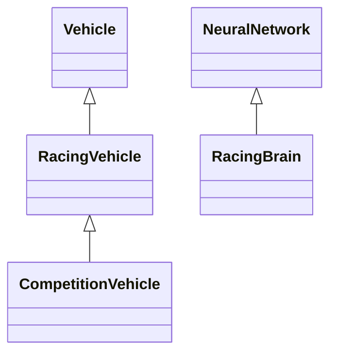

# AI Racing Evolution Simulator — Nice Circuit

Projet universitaire d'IA réactive : des voitures apprennent à parcourir un circuit
par neuro-évolution, puis leurs cerveaux sont évalués et mis en compétition.
Technologies : JavaScript, p5.js 0.8.0 et TensorFlow.js 1.1.0, versions du cours
conservées. Mini-projet ML5 séparé inclus. Référentiel retenu pour la remise :
pages **physiques 52–55** du PDF *Steering behaviors Master Miage IA2*, sujet
Nice 2025–2026, conformément à la mission de finalisation. Les échéances anciennes
du PDF ne sont pas transposées automatiquement à la promotion actuelle.

## Liens du projet

- **Code source GitHub :** [AI-Racing-Simulator](https://github.com/AbderrahmaneNahhal/AI-Racing-Simulator)
- **Jeu hébergé sur GitHub Pages :** [Jouer au simulateur](https://abderrahmanenahhal.github.io/AI-Racing-Simulator/)
- **Vidéo de démonstration YouTube :** [Voir la démonstration](https://www.youtube.com/watch?v=Bw3p5AK3I1I)

## Identité universitaire

- **Auteur :** NAHHAL Abderrahmane
- **Groupe :** Groupe 1
- **Promotion :** 2026/2027
- **Formation :** Master IA2 — Intelligence Artificielle Appliquée
- **Université :** Université Côte d'Azur
- **Établissement partenaire :** EMSI Casablanca
- **Module :** Intelligence Artificielle Réactive

## Lancement et hébergement statique

Aucun build ni paquet npm à installer. Ouvrir ce dossier dans **VS Code Live Server**, ou lancer depuis ce dossier avec Python installé :

```powershell
python -m http.server 8000 --bind 127.0.0.1
```

Ouvrir <http://127.0.0.1:8000/>. Utiliser localhost ou HTTPS, pas `file://`.
Internet est nécessaire pour les CDN p5.js, TensorFlow.js et ML5.

Le projet est publié depuis la racine du dépôt sur GitHub Pages. Le 21 octobre 2026,
le dépôt et la page publique répondent en **HTTP 200** ; la page servie référence
bien le script du simulateur. Ce contrôle HTTP ne constitue pas une nouvelle
validation interactive de tous les modes de jeu.
Le fichier `index.html` est à la racine et les chemins locaux sont relatifs.

**Exporter les champions JSON avant de changer d'origine** : IndexedDB est propre
à l'origine du navigateur. Les cerveaux locaux ne sont pas transférés automatiquement.

## Modes et contrôles

- **Training** : population, sélection et mutation. Play/Pause/Reset, vitesse
  ×1–×10, progression, succès et graphique par génération.
- **Demo** : importer un cerveau JSON ; une voiture aux poids figés, sans mutation
  ni reproduction. Changer de circuit mesure une autre condition ; Reset réutilise
  le même cerveau. Revenir à Training recrée une population.
- **Contre-la-montre** : 2–8 cerveaux, mêmes conditions initiales que Training,
  départs décalés lorsque la zone est libre, attente sans simulation ni rendu
  superposé. Aucune interaction ; classement des arrivants par pas actifs.
- **Simultanée** : grille orientée sûre, séparation/évitement, suivi/freinage et
  dépassement si le couloir est libre. Pas de mutation ni de réentraînement.

Training → Race conserve population, cerveaux, historique, paramètres, circuit,
caméra et état d'arrêt. Retour en pause. Accueil suspend sans réinitialiser.
Cliquer sur une voiture pour la sélectionner ; Capteurs/D, Checkpoints, zoom,
suivi et Vue globale restent disponibles. Le dessin des voitures reste **×2**.

## Architecture et héritage Vehicle



Training/Demo instancient `RacingVehicle`, Race instancie `CompetitionVehicle`.
Les constructeurs délèguent au parent, les forces passent par `applyForce` et la
locomotion reste héritée de `Vehicle.update`. Les cinq fichiers pédagogiques
`vehicle.js`, `ga.js`, `nn.js`, `ray.js`, `boundary.js` sont inchangés.

| Modules | Responsabilité |
|---|---|
| `racingVehicle.js`, `CompetitionVehicle.js` | Entités spécialisées et diagnostics/rendu. |
| `racingBrain.js`, `trainingConfig.js`, `brainStorage.js` | Réseau, validation et JSON compatibles. |
| `sketch.js`, `evolution.js`, `simulationModes.js` | Boucle, générations, arrêt et préservation des sessions. |
| `raceSession.js`, `raceGrid.js`, `raceInteractions.js` | Compétition, steering et contraintes de contacts. |
| `tracks.js`, `trackStorage.js` | Presets, génération et interchange de circuits. |
| `garageStore.js`, `garageService.js`, `garageDashboard.js` | IndexedDB, vérification et bibliothèque. |
| `dashboard.js`, `simulationControls.js`, `raceDashboard.js`, `performanceChart.js` | Interface et mesures une fois par frame. |
| `camera.js`, `scenery.js`, `sceneryViewport.js`, `racingArt.js`, `appShell.*` | Présentation sans déplacement des agents. |
| `ml5-demo/` | Atelier ML5 isolé du simulateur. |

## Perception, steering et physique

Les rayons couvrent 90° : angle `-45 + i × 90 / capteurs`. Chaque entrée vaut
`1 − distanceDuMur / SIGHT`. Le réseau produit un angle relatif et une vitesse
désirée. `Vehicle.look` calcule `steering = vitesseDésirée − vitesseActuelle`,
avec force limitée à 0,2 et vitesse limitée à 5 unités/pas.

La locomotion fournie fait `pos += vel`, puis `vel += acc`, limite la vitesse et
remet l'accélération à zéro. Training/Demo conservent l'ordre
`applyBehaviors → check → update`. Il n'y a pas de trajectoire préenregistrée.

En simultanée, les comportements locaux combinent risque par vitesses relatives,
séparation, évitement, freinage/suivi et couloir de dépassement. Les forces sont
pondérées et limitées ; une manœuvre aggravant le risque de mur est rejetée.
La tangente locale sert de repère au départ arrêté et de contrainte de marche
arrière, sans remplacer le cerveau par un suivi de chemin imposé.

L'évitement ne garantit pas à lui seul les contacts : des **disques de rayon 8**
sont testés continûment avant le prochain déplacement hérité. La réponse bloque
la vitesse dangereuse sans téléportation. Un corps terminé reste visible et
solide six pas avant retrait. Le modèle fourni de collision aux murs repose
sur les rayons (distance <5), pas sur une carrosserie rectangulaire continue.

## Réseau neuronal et paramètres

Les curseurs affichent leur valeur numérique. Modifier puis **Appliquer et
réinitialiser** recrée des réseaux compatibles en pause, sans altérer le Garage.

| Paramètre | Domaine / valeur initiale |
|---|---|
| Population | 10–300 / 100 |
| Mutation | 0–100 % / 10 % |
| Entrées / capteurs | 3–15 / 6 |
| Distance de vision | 20–200 / 50 |
| Couches cachées | 1–3 / 1 |
| Neurones de chaque couche | 4–48, largeur indépendante / 12 |
| Activation des couches cachées | Sigmoid ou ReLU / Sigmoid |

Exemple effectif : **6 → 12 → 8 → 2**. Les curseurs supplémentaires apparaissent
selon le nombre de couches. La topologie affichée correspond aux modèles actifs.
ReLU modifie réellement leurs calculs. Les **sorties restent sigmoïdes**, car
l'interprétation physique de direction/vitesse attend des valeurs entre 0 et 1.

Les anciens cerveaux `ai-racing-brain` v1 sans nouveaux champs gardent exactement
Sigmoid et des couches uniformes. ReLU ou les largeurs non uniformes s'exportent
en **v2** ; les Sigmoid uniformes restent exportables en v1. Les deux formats
sont acceptés, avec validation des formes et des valeurs, sans modifier les poids.
Un ancien exécutable n'est pas censé comprendre les nouveaux v2.

## Algorithme génétique et fitness

La progression brute est le nombre de checkpoints franchis dans l'ordre, sur 60.
Le checkpoint 0 clôt le tour ; aucun checkpoint n'est offert au départ.
Avant la sélection, le code fourni transforme la progression en
`score = 2^min(progression,500)`, puis en probabilités normalisées. Une réduction
par le maximum préserve la stabilité numérique.

La roulette pondérée choisit un parent, copie son réseau puis applique la mutation
gaussienne héritée à chaque paramètre avec la probabilité configurée. Pas de
rétropropagation en Training, crossover ajouté ou élitisme non muté. L'archive du
meilleur cerveau est distincte de la population reproduite. `evolution.js` fournit
la fabrique configurable ; la normalisation de `ga.js` reste réutilisée.

La fitness ne récompense pas directement le temps. Race classe par pas actifs.
Les probabilités de sélection ne sont pas des checkpoints. Les statistiques sont
capturées avant normalisation. Les courbes affichent la meilleure progression et
la moyenne des générations terminées ; les 60 dernières sont visibles et
l'historique complet reste en mémoire jusqu'au Reset.

## Arrêt automatique de Training

Dans **Arrêt automatique**, activer indépendamment un maximum de générations
terminées et/ou un objectif de réussite (pourcentage de voitures arrivées).
Cliquer **Appliquer les conditions**. Les deux critères sont désactivés par défaut.
Si plusieurs critères sont actifs, le premier satisfait suffit.

L'évaluation se fait à la fin d'une génération, **avant** normalisation,
reproduction ou destruction des parents. Statistiques et champion restent
disponibles et la raison s'affiche. Export/Garage restent utilisables.
**Play** reproduit les parents conservés et reprend ; les critères sont réévalués
à la prochaine fin de génération, sauf désactivation. **Reset** recommence la
série avec les mêmes réglages et critères. L'état d'arrêt survit aux changements
de mode ; il n'est pas une propriété d'un cerveau JSON ni une règle Demo/Race.

## Garage IA et export des champions

1. Laisser Training progresser ou terminer une génération.
2. Choisir éventuellement un nom et **Ajouter le champion au Garage**.
3. Le succès n'est annoncé qu'après confirmation de la transaction IndexedDB.
4. En Race, choisir 2–8 cerveaux du Garage, un circuit et un format, préparer puis Start.
5. Dans le Garage, **Export JSON** crée un fichier portable pour la remise ou le partage.
   **Import JSON** le recharge. Training propose aussi l'export du meilleur cerveau archivé.

Les captures de génération en cours sont distinguées des résultats archivés.
Les anciennes métadonnées manquantes restent inconnues. À modèle et poids
identiques, une meilleure progression actualise la provenance sans dupliquer le
cerveau, changer son nom/identifiant ni réécrire ses poids. Une moins bonne ne
remplace pas la meilleure. Les renseignements absents d'une nouvelle observation
ne sont pas inventés à partir d'un événement plus ancien.

IndexedDB n'est pas effacé ni migré destructivement. Le Garage est propre à
l'**origine** : localhost, GitHub Pages et itch.io ne partagent pas leurs données.
**Exporter les vrais champions avant de changer d'origine** et joindre les JSON
à la remise. Une bibliothèque locale n'est pas automatiquement livrée avec Git.

## Génération, sauvegarde et restauration des circuits

Facile (graine 124), Moyen (428) et Difficile (739) restent disponibles et inchangés.
Dans **Générateur et sauvegarde de circuits**, choisir base, graine, complexité et
demi-largeur, puis **Générer et utiliser**. La variante validée devient Personnel,
également utilisable en Race. Cette action recommence la session en pause.

- **Sauvegarder / Restaurer circuit** : un emplacement localStorage.
- **Exporter / Importer circuit JSON** : format `ai-racing-track` v1.
- Le fichier conserve nom, monde 1200×800, 60 checkpoints, paramètres complets,
  graine et **sommets exacts**. Ces sommets sont l'autorité à l'import, sans
  approximation due à une autre version du bruit.
- Validation avant utilisation : bornes, segments dégénérés, ordre et nombre des
  sommets, auto-intersections, bordures/checkpoints croisés, chaussée et largeur.
  Un JSON invalide ne remplace pas le circuit.
- Un seul emplacement Personnel est actif ; plusieurs fichiers permettent d'en
  conserver plusieurs. Une configuration d'entraînement sauvegardée sur Personnel
  embarque aussi son circuit exact.

Il s'agit d'un **générateur paramétrique**, pas d'un éditeur graphique. Certaines
combinaisons sont rejetées : changer de graine, réduire la complexité ou élargir
la piste. Pour reproduire un essai sur une variante, conserver cerveau **et** circuit.

## Généralisation : entraînement et évaluation

Un cerveau entraîné sur un circuit ne garantit pas la réussite avec un autre
départ ou du trafic. Demo utilise les mêmes poids sans mutation. Le
contre-la-montre est la référence de départ Training ; la simultanée ajoute grille,
contraintes locales et interactions. Ne pas attribuer automatiquement leurs
différences à un manque de généralisation neuronale.

En simultanée, le premier seuil de compteur est 150, puis le seuil Training 25.
La comparaison stricte `counter > seuil` élimine au 151e ou au 26e update sans
progression. Un trafic prouvé peut suspendre le compteur au plus 60 pas consécutifs
et 180 cumulés, sans réduire le temps de course. Aucun checkpoint artificiel.

Protocole conseillé : exporter un vrai champion ; fixer poids/circuit/départ,
mesurer progression, cause et pas actifs ; changer ensuite une seule condition
à la fois. Les fixtures de tests ne sont pas des champions. Aucun résultat 8/8
ni taux réel d'entraînement n'est fabriqué dans cette livraison.

## Mini-projet ML5 réel et indépendant

Ouvrir [ml5-demo/index.html](ml5-demo/index.html), ou Atelier ML5 dans Training.
Cliquer **Charger ML5 et les exemples**, choisir une couleur puis **Classer avec ML5**.
On peut ajouter ses propres couleurs et familles, jusqu'à 64 exemples par visite.

L'API réelle **ML5 0.12.2**, `ml5.KNNClassifier()`, apprend huit exemples RGB
étiquetés et `classify(...,3)` renvoie les votes de voisins. Les exemples sont
manuellement définis pour cet atelier ; ce ne sont pas des cerveaux automobiles
ou des mesures scientifiques du simulateur. Le vote n'est pas une probabilité
calibrée, et le descripteur RGB ne reconnaît pas une voiture dans une photo.

La page est isolée : aucune caméra, aucun micro, aucune substitution du TF.js 1.1
du simulateur. Le CDN ML5 est chargé seulement après action utilisateur. Le test Edge décrit dans le README antérieur, absent de cette copie,
exécute une véritable prédiction et vérifie l'absence d'effet sur les tenseurs
du simulateur. Références : [exemples officiels ML5](https://ml5js.github.io/ml5-examples/public/)
et [bibliothèque ML5](https://github.com/ml5js/ml5-library).

## Tests, performances et limites

Le README antérieur rapporte **125/125 tests unitaires réussis** avant préparation
et une intégration complète **Edge réussie depuis la copie de livraison** :
Training, Demo, Garage et persistance, les deux formats Race (2–8, ×1/×10), JSON,
circuits et véritable prédiction ML5. Aucune erreur JavaScript non interceptée observée.
Les tests, captures et audits restent dans le projet original, hors de cette copie statique.

- ×1–×10 désigne des pas par frame, pas une multiplication de la physique. Le
  temps réel dépend du FPS, le classement utilise les pas actifs.
- Pas de garantie universelle de 60 FPS avec 300 voitures ou à ×10.
- Collision aux murs par rayons fournis ; contacts inter-voitures uniquement en simultanée.
- Les silhouettes ×2 peuvent se chevaucher avant les disques physiques de rayon 8.
- Les risques évités sont une estimation, pas une preuve causale.
- Reset efface historique et champion de la série, **pas le Garage**.
- Les compteurs de tenseurs ne mesurent pas toute la mémoire du navigateur.
- Les CDN nécessitent Internet, y compris après publication statique.

## MON EXPERIENCE

### Choix du projet

Je présente un simulateur de voitures autonomes parce qu'il permet de relier des
notions abstraites à un comportement observable : percevoir les murs, choisir une
direction et adapter une vitesse. J'y étudie l'articulation entre l'IA réactive,
les capteurs et l'apprentissage par neuroévolution. La distinction entre objectif,
force de pilotage et locomotion, rappelée dans les consignes du projet, me donne
un cadre pour analyser les décisions des agents sans recourir à une trajectoire
prédéfinie.

### Développement et fonctionnalités

Mon projet comprend un mode Training dans lequel une population de voitures est
évaluée sur un circuit. Les capteurs mesurent la proximité des murs ; leurs valeurs
alimentent un réseau neuronal qui produit une direction et une vitesse désirées.
La progression aux checkpoints sert à calculer la fitness. L'algorithme génétique
sélectionne des parents par roulette pondérée, copie leurs réseaux et applique des
mutations pour former la génération suivante. Ce mécanisme permet d'étudier une
évolution des comportements sans rétropropagation pendant Training.

Je peux configurer l'architecture du réseau, notamment le nombre de couches cachées
et leur largeur respective, ainsi que l'activation Sigmoid ou ReLU. Les sorties
restent sigmoïdes pour respecter l'intervalle attendu par le pilotage. Les circuits
prédéfinis et le générateur paramétrique permettent de varier les conditions ;
les circuits personnalisés peuvent être sauvegardés et échangés en JSON.

Le Garage conserve les cerveaux entraînés dans IndexedDB et permet leur import
et leur export. Je peux ainsi réutiliser des poids figés en Demo et comparer des
cerveaux en Race, en contre-la-montre ou en course simultanée. Ces deux formats
n'imposent pas les mêmes contraintes : la course simultanée ajoute des interactions
locales entre véhicules. L'atelier ML5.js, présent dans un dossier séparé, illustre
une autre approche avec un classifieur KNN de couleurs RGB ; il n'entraîne pas les
cerveaux des voitures.

### Réglages et expérimentations

Je dispose de réglages pour la population (10 à 300 voitures), la mutation
(0 à 100 %), les capteurs (3 à 15), la distance de vision (20 à 200), les couches
cachées (1 à 3) et leur largeur (4 à 48 neurones). Les critères d'arrêt peuvent
porter sur le nombre de générations terminées ou sur un objectif de réussite.
La vitesse d'exécution, de ×1 à ×10, change le nombre de pas par image.

Pour comparer des configurations, je peux conserver le circuit et les conditions
de départ, puis modifier un seul paramètre. La progression, le taux de réussite
par génération et les pas actifs en Race fournissent des indicateurs distincts.
Je distingue ce protocole possible de résultats effectivement établis : aucun
journal d'expériences personnelles ni résultat chiffré de champion n'est joint à
cette livraison. Je ne conclus donc pas à la supériorité d'une configuration.

### Difficultés et solutions vérifiables

Dans mon analyse du code, la fiabilité de la sauvegarde est un point de vigilance.
Le Garage attend la fin de la transaction IndexedDB, via `transaction.oncomplete`,
avant de confirmer une écriture ; le succès d'une requête isolée ne suffit pas.
Les erreurs et interruptions de transaction sont prises en charge. Cette solution
est visible dans `garageStore.js`, sans que j'attribue ici une chronologie de bugs
ou de corrections à des essais personnels non documentés.

La compatibilité des cerveaux constitue un autre enjeu. Les validations contrôlent
la topologie, les dimensions des poids et leurs valeurs. Le format v1 conserve
les configurations Sigmoid à couches uniformes ; ReLU ou des largeurs différentes
nécessitent le format v2. Cette distinction permet de réutiliser les anciens
cerveaux tout en explicitant les limites de compatibilité.

Pour la livraison, je retiens également la séparation entre publication du code
et disponibilité du site. Le premier contrôle GitHub Pages renvoyait HTTP 404 ;
le contrôle actuel répond HTTP 200 et sert la page du simulateur. Le stockage du
Garage reste propre à chaque origine : un export JSON est nécessaire pour
transférer les cerveaux de localhost vers le site publié.

### IDE et assistance par IA

J'utilise **Visual Studio Code** comme IDE. **Codex** intervient dans l'analyse du
code, les modifications, les vérifications et la préparation de la livraison.
**ChatGPT** est utilisé pour préparer les consignes, accompagner le travail et
structurer la documentation. Le développement est donc assisté par IA ; je ne
présente pas l'ensemble du code comme ayant été écrit manuellement.

Ces noms désignent des outils et services, et ne permettent pas d'identifier les
modèles sous-jacents : **Versions exactes des modèles IA non documentées**.
Les consignes et prompts réellement conservés restent accessibles dans le dépôt.

### Bilan

Ce travail me permet de mettre en relation les entrées d'un réseau neuronal, ses
sorties et le déplacement d'un agent autonome. Il donne un support concret pour
comprendre la sélection et la mutation des réseaux, ainsi que la différence entre
apprentissage, réutilisation d'un cerveau et évaluation en compétition. J'en retiens
que la réussite dans une condition donnée ne suffit pas à démontrer la
généralisation : le circuit, le départ et les interactions doivent être précisés.

## Consignes IA et documentation conservées

Les consignes réellement utilisées sont conservées intégralement dans
[consignes-ia/AGENTS.source.md](consignes-ia/AGENTS.source.md) et
[consignes-ia/ARCHITECTURE.source.md](consignes-ia/ARCHITECTURE.source.md).
Ces copies pédagogiques contiennent des renvois historiques au dépôt du cours ;
ce ne sont pas des dépendances d'exécution. Les documents `assets/*.md` conservent
la provenance et les prompts des visuels, y compris leur historique.

## Crédits, ressources et licences

- **Code pédagogique fourni dans le cadre du cours :** `vehicle.js`, `ga.js`,
  `nn.js`, `ray.js` et `boundary.js`. Ils sont préservés ; leur présence dans ce
  dépôt ne vaut pas attribution exclusive à l'étudiant. La référence vidéo
  présente dans `ray.js` est conservée. **Licence ou autorisation à vérifier**
  pour la redistribution du code pédagogique ; aucun texte de licence générale
  n'est fourni dans cette copie.
- **Référence conceptuelle :** Craig W. Reynolds, « Steering Behaviors for
  Autonomous Characters », GDC 1999, mentionnée dans les consignes du cours.
  Le PDF cité par ces archives n'est pas inclus dans cette livraison.
- **Bibliothèques externes :** p5.js 0.8.0 et son extension DOM, TensorFlow.js 1.1.0,
  ainsi que ML5.js 0.12.2 dans l'atelier séparé, chargés depuis des CDN. Ces
  bibliothèques restent soumises à leurs propres licences ; leurs textes ne sont
  pas inclus dans cette copie. **Licence ou autorisation à vérifier** auprès des
  projets respectifs avant redistribution de leurs fichiers.
- **Ressources graphiques :** les documents
  [PROMPTS](assets/PROMPTS.md) et
  [MEDITERRANEAN_ASSETS](assets/MEDITERRANEAN_ASSETS.md) décrivent les générations
  avec imagegen et les références visuelles fournies. Leurs attributions et
  prompts sont préservés. Certaines mentions décrivent des versions historiques
  absentes de la copie actuelle. La provenance détaillée de chaque variante
  d'accueil et les droits sur les images de référence ne sont pas entièrement
  établis : **Licence ou autorisation à vérifier**.
- **Ressources sonores :** aucun fichier audio n'est présent dans cette livraison.
  Les mentions sonores des consignes historiques concernent d'autres exemples
  du cours et ne constituent pas des crédits audio du simulateur.

Aucune licence MIT globale n'est déclarée pour ce projet. Les droits des composants
et des références doivent être distingués de la contribution de l'étudiant.

Les résultats historiques de tests indiqués plus haut sont ceux rapportés par le
README antérieur. Les scripts et rapports correspondants sont absents de cette
copie statique ; ces résultats n'ont pas été réexécutés lors de la finalisation
documentaire. Avant remise, il reste à relire personnellement le récit, vérifier
les autorisations et joindre les véritables exports de champions si requis.